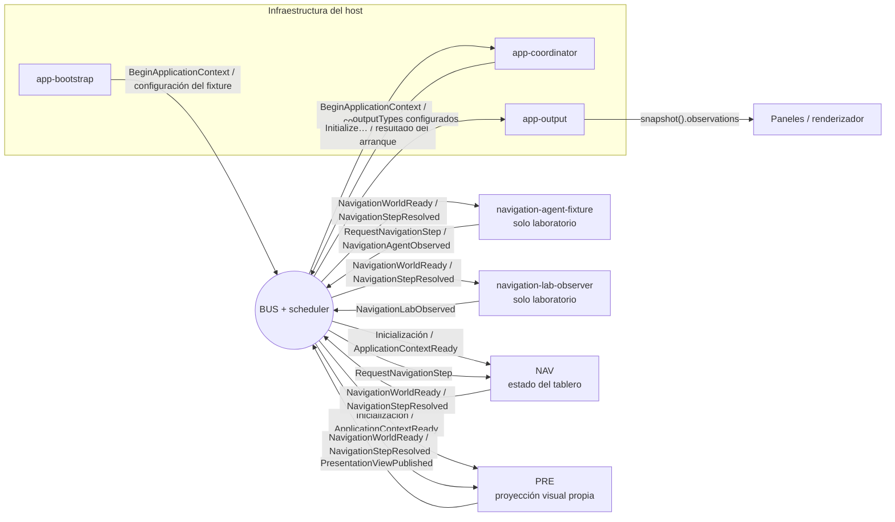
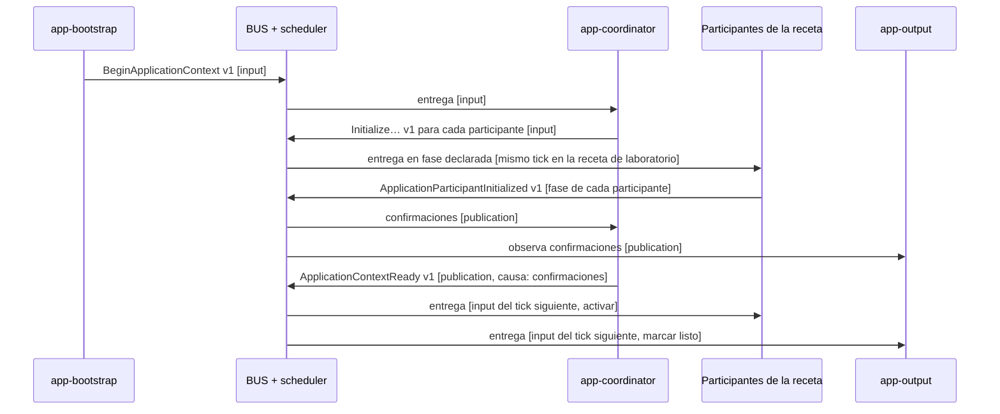
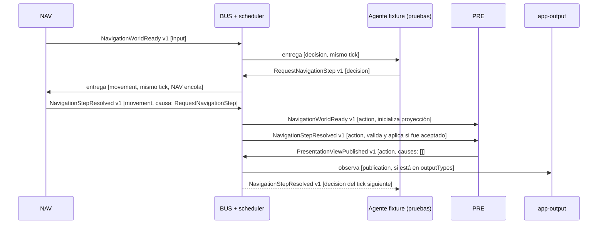

# Mapa de mensajes y recorridos

Revisión: **1.0.0**. Corte documental: **14 de octubre de 2026**.

> Este mapa se elaboró sobre el checkout `C:/dev/robots`, en la rama `codex/fix-system-coupling` y con base `44038c9`. Describe los flujos de esa revisión; sus enlaces a fuentes permiten contrastarlos con la implementación vigente.

## Alcance

El catálogo cubre APP v1, NAV v1 y PRE v1, además de los mensajes del fixture de laboratorio usado para conectar navegación y presentación. No incluye mensajes efímeros de pruebas unitarias ni sistemas de gameplay que todavía no tienen una implementación conectada al bus.

La composición concreta del laboratorio está en [navigation-fixture.ts](../../tests/core/navigation-fixture.ts) y [presentation-fixture.ts](../../tests/core/presentation-fixture.ts). `presentationRecipe()` agrega PRE a la receta NAV y conserva dos actores fixture: un agente que decide pasos y un observador del laboratorio. Esos dos actores sirven para demostrar el recorrido; no son sistemas de decisión o telemetría del producto.

## Cómo leer el mapa

- Un **comando** solicita una acción a un responsable; un **evento** informa un hecho o publica una observación.
- Los tipos y payloads se declaran en [protocol](../../packages/protocol/src/index.ts). El host asigna los productores autorizados, el responsable de cada comando, las fases y la composición efectiva en cada receta.
- Los receptores efectivos son los participantes que monta la receta y sus suscripciones. `app-output` escucha además los tipos listados en `Recipe.outputTypes`.
- La entrega nunca llama al receptor en el instante de publicar. El scheduler procesa mensajes por fases: `input → perception → decision → movement → action → resolution → publication`. Un receptor en una fase posterior puede recibir en el mismo tick; si su fase ya pasó o coincide con la fase desde la que se publicó, recibe en el siguiente tick.
- Las flechas del diagrama siempre pasan por `BUS`. No representan llamadas directas entre NAV, PRE ni los fixtures.

## Sistemas y piezas que participan

| Pieza | Papel en la comunicación |
| --- | --- |
| `runtime` | Ejecuta el bus, la sesión y el scheduler. No es un sistema de dominio. |
| `application-host` | Compone participantes y permisos; coordina inicio/cierre y recoge las observaciones seleccionadas. |
| `app-bootstrap` | Adaptador de entrada del host. Inicia el contexto y puede entregar comandos externos autorizados por la receta. |
| `app-coordinator` | Sistema interno del host. Distribuye inicializaciones, valida confirmaciones y publica el resultado del arranque. |
| `app-output` | Sistema interno del host. Registra estado de inicialización y mensajes elegidos por `outputTypes`. |
| `navigation` (NAV) | Actor de dominio. Es dueño del tablero, las posiciones, ocupación, revisiones y disponibilidad de movimiento. |
| `presentation` (PRE) | Actor de dominio. Construye su propia proyección visual a partir de mensajes de NAV y publica una vista. |
| `navigation-agent-fixture` | Actor de demostración/pruebas. Planifica un paso y envía `RequestNavigationStep`; no es IA de producto. |
| `navigation-lab-observer` | Actor de demostración/pruebas. Mantiene una vista para el panel de navegación y publica diagnósticos. |
| `presentation-three` y paneles del laboratorio | El panel lee observaciones del host y le pasa la vista al renderizador Three.js; ninguno se suscribe directamente al bus. |
| `protocol`, `system-api`, `values`, `content` | Bibliotecas de contratos, tipos y lógica pura/validación. No son receptores del bus en esta composición. |

En el flujo de la UI, el host guarda los mensajes de salida en `snapshot().observations`; por ejemplo, el panel de presentación lee la observación cuya clave es `presentation`. El renderizador Three.js consume esa vista desde el host, no desde una suscripción propia al bus. Véase [presentation-panel.ts](../../tests/browser/presentation-panel.ts).

## Vista general

La composición que incluye PRE añade `PresentationViewPublished` a `outputTypes`; la receta NAV ya incluye `NavigationAgentObserved` y `NavigationLabObserved`. Por eso `app-output` observa esos eventos al publicarse. En otra receta, la lista de observaciones y los receptores pueden ser distintos.

## Catálogo de mensajes

Las fases de productores y receptores indican cuándo se autoriza/publica y cuándo se ejecuta el handler. `app-output` recibe eventos de dominio en `publication` solo si la receta los incluye en `outputTypes`.

### Ciclo de aplicación — host

| Mensaje | Clase | Productor autorizado → fase | Receptores → fase | Efecto del handler |
| --- | --- | --- | --- | --- |
| `BeginApplicationContext@1` | Comando | `app-bootstrap` → `input` | `app-coordinator` → `input` | Registra el mensaje raíz del intento y envía a cada participante su comando de inicialización. |
| `Initialize…@1` | Comando generado por receta | `app-coordinator` → `input` | El participante nombrado → fase declarada por ese participante | Inicializa solo el estado propio del participante; normalmente publica `ApplicationParticipantInitialized`. En el laboratorio se concretan, entre otros, `InitializeNavigationBoard`, `InitializeNavigationAgentFixture`, `InitializeNavigationObserverFixture` y `InitializePresentationView`. |
| `ApplicationParticipantInitialized@1` | Evento | Cada participante → su fase de inicialización | `app-coordinator` y `app-output` → `publication` | El coordinador valida identidad, emisor y correlación raíz, y guarda la confirmación. `app-output` elimina al participante de pendientes. |
| `ApplicationParticipantRejected@1` | Evento | Cada participante → su fase de inicialización | `app-coordinator` y `app-output` → `publication` | El coordinador registra el rechazo. El handler de `app-output` no modifica estado para este tipo; el coordinador publica después el rechazo global. NAV y PRE actuales no emiten este evento en el recorrido normal; el contrato permite que un participante lo haga. |
| `ApplicationContextReady@1` | Evento | `app-coordinator` → `publication` | Todos los participantes y `app-output` → `input` | Se publica tras confirmar a todos los participantes. Cada actor se activa; `app-output` marca el contexto como listo. La entrega ocurre en el tick siguiente. Causado por las confirmaciones. |
| `ApplicationInitializationRejected@1` | Evento | `app-coordinator` → `publication` | `app-output` → `input` | Informa rechazo de participante o límite de inicialización; el host guarda el motivo. Causado por el mensaje raíz `BeginApplicationContext`. |

`BeginApplicationContext` y `Initialize…` se construyen con las definiciones de [application/v1](../../packages/protocol/src/application/v1.ts). Las autorizaciones y suscripciones se montan en [assembly.ts](../../packages/application-host/src/assembly.ts) y [bindings.ts](../../packages/application-host/src/bindings.ts).

### Dominio NAV/PRE — contrato v1

| Mensaje | Clase | Productor autorizado → fase | Receptores en la composición de laboratorio → fase | Efecto del handler |
| --- | --- | --- | --- | --- |
| `NavigationWorldReady@1` | Evento | NAV → `input` | PRE → `action`; agente fixture → `decision`; observador fixture → `action` | PRE valida identidad/ensamblados y crea su proyección. El agente y el observador inicializan vistas propias del laboratorio. |
| `RequestNavigationStep@1` | Comando | Configurado por el host. En esta receta: `navigation-agent-fixture` → `decision` | NAV → `movement` | NAV encola la solicitud (límite 256), ordena por `messageId`, valida contra el tablero vigente y actualiza exclusivamente su estado si acepta el paso. |
| `NavigationStepResolved@1` | Evento | NAV → `movement` | PRE → `action`; agente fixture → `decision`; observador fixture → `action` | PRE ignora rechazos/duplicados y valida continuidad de revisiones antes de actualizar su proyección. Los fixtures actualizan sus propias vistas; el observador conserva hasta 16 resultados. PRE y observador reciben en el tick actual; el agente fixture, cuya fase `decision` ya pasó, recibe en el tick siguiente. |
| `PresentationViewPublished@1` | Evento | PRE → `action` | `app-output` → `publication`, si figura en `outputTypes` | PRE publica su proyección inmutable; el host la conserva bajo el ID del productor (`presentation`). La publicación actual usa `causes: []`. |

Los contratos de dominio están en [navigation/v1](../../packages/protocol/src/navigation/v1.ts) y [presentation/v1](../../packages/protocol/src/presentation/v1.ts); los handlers están en [NAV](../../packages/navigation/src/actor.ts) y [PRE](../../packages/presentation/src/actor.ts).

### Mensajes del laboratorio — solo fixture

| Mensaje | Clase | Productor autorizado → fase | Receptor → fase | Efecto del handler |
| --- | --- | --- | --- | --- |
| `ConfigureNavigationFixture@1` | Comando | `app-bootstrap` → `input` | `navigation-agent-fixture` → `decision` | Encola configuración (límite 256); el fixture valida la secuencia y los objetivos antes de reemplazar su configuración local. |
| `NavigationAgentObserved@1` | Evento | `navigation-agent-fixture` → `decision` | `app-output` → `publication`, por `outputTypes` | Publica planes, estado de su vista y contadores del planificador. El host los expone en `observations["navigation-agent-fixture"]`. |
| `NavigationLabObserved@1` | Evento | `navigation-lab-observer` → `action` | `app-output` → `publication`, por `outputTypes` | Publica la vista del observador y un historial acotado de resultados. El host los expone en `observations["navigation-lab-observer"]`. |

Estos tres contratos se definen al componer [navigationRecipe](../../tests/core/navigation-fixture.ts). `presentationRecipe` agrega el actor PRE, su binding y su tipo de salida en [presentation-fixture.ts](../../tests/core/presentation-fixture.ts).

## Secuencia de inicialización

El diagrama resume el camino feliz del host. Las fases particulares de inicialización aparecen en el catálogo; aquí se muestran NAV y PRE para mantener legible el orden.

Si un participante rechaza o no confirma dentro del presupuesto, el coordinador publica `ApplicationInitializationRejected@1` en lugar de `ApplicationContextReady@1`.

## Secuencia de un paso de navegación

El agente que origina el comando en esta composición es un fixture. El flujo de dominio no requiere que NAV conozca su implementación: el host autoriza al productor y NAV escucha el contrato.

Si el resultado es rechazado o duplicado, PRE no cambia su proyección. Si es aceptado, comprueba la revisión y la posición anterior antes de actualizarla. `NavigationStepResolved` lleva causalidad explícita hacia el comando que lo originó. PRE incluye el ID del mensaje de movimiento dentro de los datos de su vista, pero la metadata causal de `PresentationViewPublished` está vacía; el ID en el payload no equivale a una relación `causes` del bus.

El fixture `navigation-lab-observer` también escucha `NavigationWorldReady` y `NavigationStepResolved` en `action`, y luego publica `NavigationLabObserved@1`. No aparece en la secuencia principal para mantenerla legible; está incluido en el catálogo.

## Límites y referencias

- `content` valida el bundle al preparar el contexto, antes de que el host monte la sesión; no se comunica por mensajes en esta composición.
- `presentation-three` y los paneles leen observaciones del host. No son consumidores directos de `NavigationStepResolved` ni de `PresentationViewPublished` en el bus.
- Otros productores y consumidores son posibles si una receta los monta y el host enlaza sus permisos. Este catálogo describe las rutas verificadas en la receta de laboratorio actual, no una lista fija impuesta por los contratos.
- Percepción, combate, daño, inventario, progresión, persistencia y red no aparecen como actores conectados en este mapa porque aún no tienen una implementación de mensajes montada en esta composición.

Fuentes principales: [mensajería v1](messaging-v1.md), [ensamblado del host](../../packages/application-host/src/assembly.ts), [bindings del host](../../packages/application-host/src/bindings.ts), [actor NAV](../../packages/navigation/src/actor.ts), [actor PRE](../../packages/presentation/src/actor.ts), [receta NAV de laboratorio](../../tests/core/navigation-fixture.ts) y [receta PRE de laboratorio](../../tests/core/presentation-fixture.ts).
